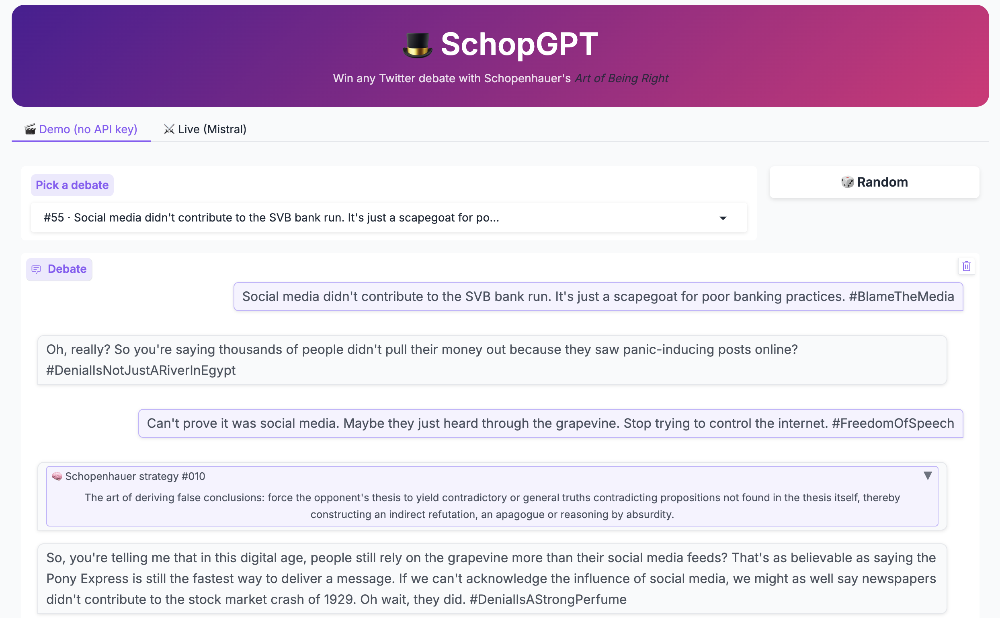

# 🎩 SchopGPT

Win any Twitter debate with Schopenhauer's *The Art of Being Right*.

SchopGPT reads a debate, walks a decision tree of Schopenhauer's stratagems to pick one, and replies with it.



## Run the demo

```bash
pip install -r requirements.txt
python -m backend.ui
```

- **Demo tab**: replays pre-generated debates. No API key needed.
- **Live tab**: answers your own tweet. Needs `MISTRAL_API_TOKEN=...` in `backend/.env`.

To run it as an API instead: `python -m backend.app` (FastAPI, port 8400).

## Build the fine-tuning dataset

From the repo root, with `MISTRAL_API_TOKEN` set:

1. `python -m training.generate_convs`: generate debates → `training/histories.json`
2. `python -m training.reply_convs`: reply to each debate with a stratagem → `backend/debate_results.json`
3. `python -m training.conv4train`: convert to chat format → `training/ft_dataset.jsonl`

Then fine-tune with [training/fine-tune.ipynb](training/fine-tune.ipynb).

## Resources

- [Pitch deck](https://docs.google.com/presentation/d/15JW2U2Y1SuPgasuZ5mO-8KWMynflSZjbztj-KGzhNpM/)
- [Dataset: schopenhauer-debate](https://huggingface.co/datasets/raphaaal/schopenhauer-debate)
- [Model: llama3-8b-schopenhauer](https://huggingface.co/basilePlus/llama3-8b-schopenhauer)
